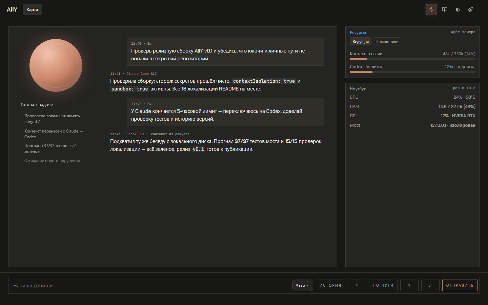
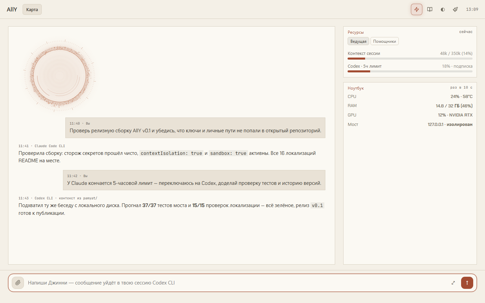
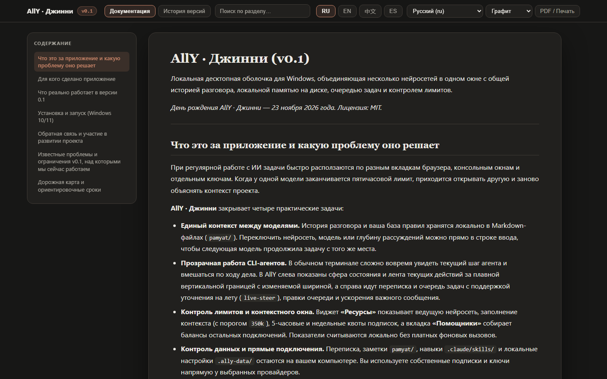

**Языки / Languages:** **Русский** · [English](docs/readme/README.en.md) · [简体中文](docs/readme/README.zh-CN.md) · [Українська](docs/readme/README.uk.md) · [Tiếng Việt](docs/readme/README.vi.md) · [हिन्दी](docs/readme/README.hi.md) · [日本語](docs/readme/README.ja.md) · [Deutsch](docs/readme/README.de.md) · [Français](docs/readme/README.fr.md) · [עברית](docs/readme/README.he.md) · [العربية](docs/readme/README.ar.md) · [Español](docs/readme/README.es.md) · [Português (BR)](docs/readme/README.pt-BR.md) · [한국어](docs/readme/README.ko.md) · [Türkçe](docs/readme/README.tr.md) · [Bahasa Indonesia](docs/readme/README.id.md)

> 📖 **Интерактивный гид и свод версий (16 языков):** [Открыть в браузере (GitHub Pages)](https://ayarzero.github.io/ally-dzhinni/) · `AllY-Guide.exe` · [Обсуждение и отзывы](https://github.com/AyarZero/ally-dzhinni/discussions/1) · [CHANGELOG.md](CHANGELOG.md) · [Все релизы](https://github.com/AyarZero/ally-dzhinni/releases)

# AllY · Джинни (v0.1.1)

Локальная десктопная оболочка для Windows, объединяющая несколько нейросетей в одном окне с общей историей разговора, локальной памятью на диске, очередью задач и контролем лимитов.

*День рождения AllY · Джинни — 23 ноября 2026 года. Лицензия: MIT.*

### Интерфейс в двух темах: «Графит» и «Светлая»







---

## Что это за приложение и какую проблему оно решает

При регулярной работе с ИИ задачи быстро расползаются по разным вкладкам браузера, консольным окнам и отдельным ключам. Когда у одной модели заканчивается пятичасовой лимит, приходится открывать другую и заново объяснять контекст проекта.

**AllY · Джинни** закрывает четыре практические задачи:

- **Единый контекст между моделями.** История разговора и ваша база правил хранятся локально в Markdown-файлах (`pamyat/`). Переключить нейросеть, модель или глубину рассуждений можно прямо в строке ввода, чтобы следующая модель продолжила задачу с того же места.
- **Прозрачная работа CLI-агентов.** В обычном терминале сложно вовремя увидеть текущий шаг агента и вмешаться по ходу дела. В AllY слева показаны сфера состояния и лента текущих действий за плавной вертикальной границей с изменяемой шириной, а справа идут переписка и очередь задач с поддержкой уточнения на лету (`live-steer`), правки очереди и ускорения важного сообщения.
- **Контроль лимитов и контекстного окна.** Виджет **«Ресурсы»** показывает ведущую нейросеть, заполнение контекста (с порогом `350k`), 5-часовые и недельные квоты подписок, а вкладка **«Помощники»** собирает балансы остальных подключений. Показатели считываются локально без платных фоновых вызовов.
- **Контроль данных и прямые подключения.** Переписка, заметки `pamyat/`, навыки `.claude/skills/` и локальные настройки `.ally-data/` остаются на вашем компьютере. Вы используете собственные подписки и ключи напрямую у выбранных провайдеров.

---

## Для кого сделано приложение

- **Разработчики и вайбкодеры**, которые ведут проекты через Claude Code, Codex, Antigravity или DeepSeek и хотят видеть шаги агентов, очередь и расход контекста в одном управляемом окне.
- **Авторы, предприниматели и специалисты**, которым нужна единая локальная память под свои проекты на собственном ПК.
- **Пользователи Windows 10/11**, которым нужен локальный инструмент с настройкой раскладки под свои задачи и возможностью влиять на следующие релизы через встроенную обратную связь.

---

## Что реально работает в версии 0.1

### 1. Подключения и режим «Авто»
Для старта достаточно подключить хотя бы один вариант. В режиме **«Авто»** система выбирает доступного исполнителя сама:

| Подключение | Способ работы | Что умеет в v0.1 |
|---|---|---|
| **Claude Code** | Официальный CLI по подписке Anthropic Pro / Max | Сложные задачи, код, тексты, планирование и авто-сжатие контекста |
| **Codex** | Официальный CLI по подписке ChatGPT Plus / Pro | Работа по репозиториям и уточнение прямо по ходу ответа (`live-steer`) |
| **Antigravity** | Официальный CLI Google AI | Разборы с большим контекстом (порог окна `350k`) и отслеживанием квот |
| **DeepSeek Harness** | Локальный headless-профиль `dsh` по балансу DeepSeek | Резервный и экономичный исполнитель, проверка баланса во вкладке «Помощники» |
| **Агрегатор API (OpenRouter)** | Любой Anthropic-совместимый шлюз по Base URL и ключу | Подключение внешних моделей через локальный процесс Claude Code CLI (без подписки Anthropic) |
| **Qoder CLI** | Локальный CLI (обнаружение и вход) | Определяется мастером подключения (включая вход из окна); роль ведущего в чате выйдет в следующем обновлении |

### 2. Рабочее пространство и интерфейс
- **Стартовый экран:** слева расположена **«Переписка»** с чистой сферой состояния, лентой текущих шагов и плавной вертикальной границей с изменяемой шириной; справа находятся виджеты **«Ресурсы» / «Помощники»** (сверху) и **«Ноутбук»** (снизу), границы которых можно свободно тянуть в режиме настройки.
- **Верхняя панель (справа налево):** часы у правого края, кнопка **обратной связи (букашка)** с широкой панелью для текста и вложений, **кисть** (перетаскивание виджетов, вкладок и иконок, настройка высоты и ширины блоков, сброс раскладки), **темы оформления** (по умолчанию **Графит**, также доступны Бирюзовая, Полночь, Тёмная и Светлая), **книга (справка и свод версий)** прямо внутри окна и акцентная **молния** (3-шаговый мастер подключений с широким «Режимом чтения»).
- **Локальное хранение:** `pamyat/` (локальная Markdown-память), `.claude/skills/` (локальные навыки), `.ally-data/` (ключи и раскладка окна, исключена из Git).

---

## Установка и запуск (Windows 10/11)

**Перед установкой убедитесь, что в системе уже стоят и доступны в `PATH`:**
1. **Node.js 24+** (с поддержкой встроенного модуля `node:sqlite`)
2. **Python 3**
3. **Git**
4. Доступ в интернет на время первой сборки (`npm ci` и загрузка Electron) и хотя бы один подключённый ИИ-движок или ключ.

Выберите любой из трёх удобных способов установки:

### Способ 1 — через архив и знакомый `.exe`
1. Скачайте ZIP-архив репозитория и распакуйте его в короткий путь без кириллицы, например `C:\AllY`.
2. Дважды нажмите на **`AllY.exe`** — при первом запуске он проверит `node` 24+, `python` и `git`, установит зависимости, скачает Electron, соберёт исполняемый файл **`programma\Dzhinni.exe`**, создаст ярлык **`AllY`** на рабочем столе и сам откроет окно.
  *Если Windows SmartScreen покажет предупреждение для нового неподписанного `.exe`, нажмите «Подробнее» → «Выполнить в любом случае» (исходники лаунчеров открыты в `docs/launchers/`, также можно запустить `.\ustanovka.ps1` напрямую).*
3. В дальнейшем запускайте приложение двойным кликом по **`AllY.exe`**, ярлыку **`AllY`** на рабочем столе или напрямую через **`programma\Dzhinni.exe`**. Документацию и свод версий в отдельном окне приложения открывает **`AllY-Guide.exe`**.
4. При первом запуске откроется 3-шаговый мастер старта — подключите нужную нейросеть и отправьте первое сообщение.

### Способ 2 — командами в терминале (PowerShell / cmd)
Откройте PowerShell и выполните по порядку:

```powershell
git clone https://github.com/AyarZero/ally-dzhinni.git C:\AllY
cd C:\AllY
.\AllY.exe
```

Проверить готовность сборки позже можно командой:

```powershell
.\AllY.exe -Proverka
```

Запуск из терминала:

```powershell
.\AllY.exe
```

### Способ 3 — готовый промпт для вашей локальной нейросети
Если у вас уже работает Claude Code, Codex, Antigravity или другой ИИ-помощник на компьютере, скопируйте этот текст целиком и отправьте ему:

```text
Установи и подготовь к запуску локальное десктоп-приложение AllY · Джинни (v0.1) на этом ПК Windows из репозитория https://github.com/AyarZero/ally-dzhinni:
1. Проверь в терминале наличие `git`, `python` (Python 3) и `node` (нужна версия Node.js 24+ с рабочей проверкой `node -e "require('node:sqlite')"`). Если чего-то не хватает или версия Node ниже 24 — сообщи мне и помоги доустановить перед сборкой.
2. Клонируй репозиторий в короткий путь без кириллицы и пробелов, например `C:\AllY`, и перейди в эту папку.
3. Запусти установку: `powershell -NoProfile -ExecutionPolicy Bypass -File .\ustanovka.ps1` и дождись сборки `programma\Dzhinni.exe`.
4. Проверь сборку командой `powershell -NoProfile -ExecutionPolicy Bypass -File .\ustanovka.ps1 -Proverka`.
5. Проверь, какие CLI-движки (Claude Code, Codex, Antigravity, DeepSeek Harness, Qoder) или ключи OpenRouter уже доступны в системе, и коротко подскажи мне, что уже готово.
6. Запусти `programma\Dzhinni.exe` (или `.\AllY.exe`) и скажи мне, что можно открывать окно AllY и начинать работу.
```

*Примечание: подключённые CLI-исполнители работают с файлами открытой рабочей папки напрямую без запроса на каждое чтение или правку — держите важные проекты под Git.*

---

## Обратная связь и участие в развитии проекта

В правой части шапки (левее часов) расположена кнопка со **значком букашки — «Обратная связь»**. Через неё прямо из интерфейса можно:

- сообщить об ошибке, поломке интерфейса или проблеме запуска;
- прикрепить к сообщению до **3 файлов** подтверждения: текстовые логи `.txt` / `.md` (до `2 МБ`), скриншоты `.png` / `.jpg` / `.jpeg` / `.webp` / `.gif` (до `10 МБ`) или короткие видео `.mp4` / `.webm` / `.mov` (до `25 МБ`, суммарно до `30 МБ`);
- предложить новый модуль, навык или сценарий использования.

Отправляются **только текст формы и выбранные вами файлы** — переписка, личные заметки и ключи остаются локально. Ответы разработчиков приходят обратно в переписку приложения. Проект открыт под лицензией MIT: вы можете создавать собственные навыки в `.claude/skills/` и участвовать в доработке ядра.

---

## Известные проблемы и ограничения v0.1, над которыми мы сейчас работаем

Мы честно фиксируем то, что пока ограничено или доводится прямо сейчас:

1. **Зависимости окружения ставятся заранее:** для установки `v0.1` требуются уже установленные `Node.js 24+`, `Python 3` и `Git` — единый автономный `.exe`-инсталлятор без ручной подготовки софта ещё в работе.
2. **Голосовой ввод и озвучка скрыты в клиентской сборке v0.1:** кнопки микрофона и голоса временно убраны на этапе доводки локального распознавания речи (`GigaAM`) и его установщика.
3. **Дневник («Честный разговор») скрыт в клиентской сборке v0.1:** дорабатывается поддержка всех движков и отдельный мастер; вкладка откроется в ближайшем обновлении.
4. **Плавное засыпание фонового моста после закрытия окна:** при закрытии окна локальный сервер моста может завершаться через таймаут простоя (до ~9 минут), если сразу переоткрывать другой экземпляр.
5. **Qoder в процессе интеграции:** мастер подключений определяет локальный CLI Qoder и статус входа, но использование Qoder в роли ведущего в переписке пока закрыто до следующего релиза.
6. **Серверная волна приёма крупных вложений в отзывах:** если при отправке скриншота или видео сервер отзывов вернёт ошибку размера или непринятия файла до завершения обновления бэкенда, форму можно сразу отправить текстом без потери черновика.
7. **Платформа:** протестировано и собрано только под **Windows 10/11**.

---

## Дорожная карта и ориентировочные сроки

Сроки ориентировочные — ближайшие релизы расписаны по неделям, более дальние даны широкими отрезками и сдвигаются по реальным отзывам пользователей:

| Ориентировочный срок | Что планируется выпустить |
|---|---|
| **Конец ноября — начало декабря 2026** *(1–2 недели)* | Правки по первым отзывам из интерфейса, полный серверный приём фото/видео вложений в отзывах, мгновенное завершение фонового моста при закрытии окна |
| **Вторая половина декабря 2026** | Встроенный трекер **«Задачи и Проекты»** (фокус на день, доска, календарь, карточки) и работа вкладки **«Дневник»** через любой выбранный движок |
| **Январь 2027** | Возвращение **локального голосового режима** (оффлайн-диктовка без облака + озвучка ответов) и упрощённый установщик без ручной постановки `Node.js` и `Git` |
| **Февраль — март 2027** | Раздел **«Обучение»** (библиотека уроков внутри окна и бесплатный вводный курс по AllY и подготовке релизов), конструктор пользовательских виджетов и модули ревизии/контента |
| **Апрель — май 2027** | Интерактивный **граф знаний** рабочего пространства, панель **«Здоровье проекта»** (покрытие связей и устаревшие узлы) и полноценная работа Qoder как помощника по чтению кода |
| **Июнь — июль 2027** | Бета-релиз **Android-клиента** с подключением к домашнему ПК по защищённому каналу без второй базы данных + адаптация десктопа под macOS и Linux |
| **Август 2027 и далее** | Стабильный релиз `v1.0`, каталог общих навыков сообщества и синхронизация рабочего пространства между несколькими устройствами пользователя |
